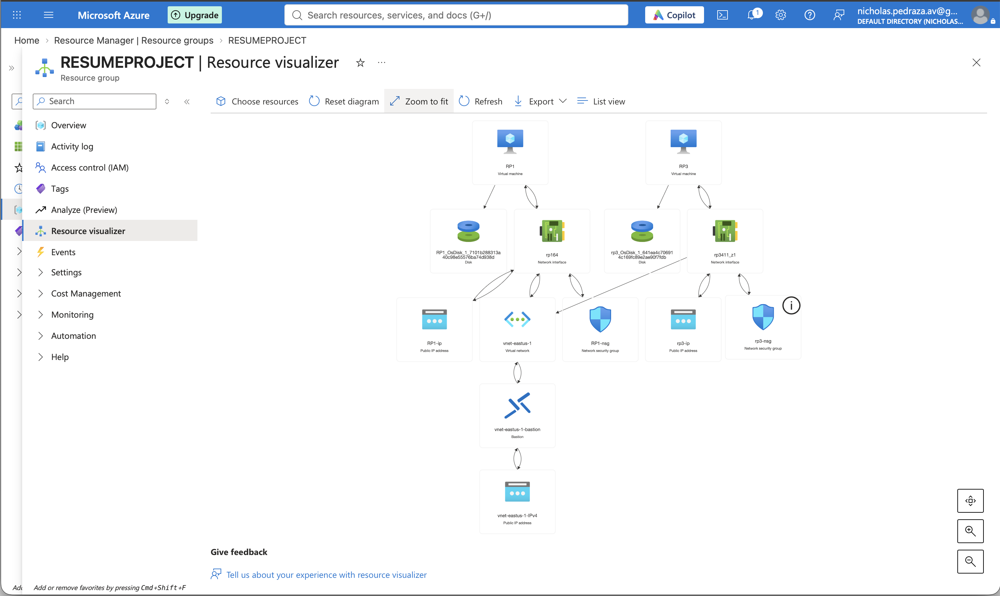
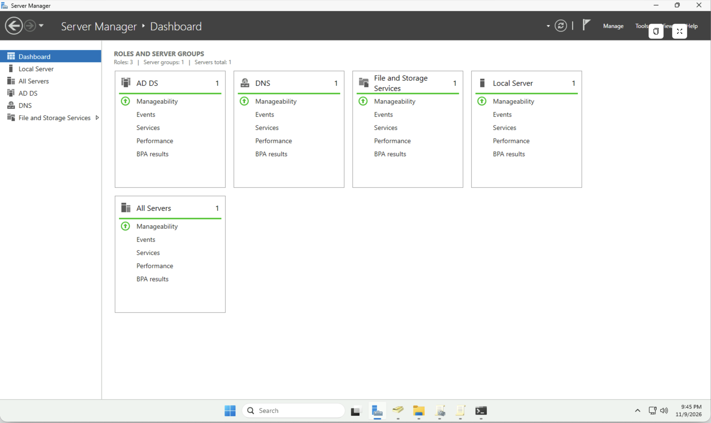
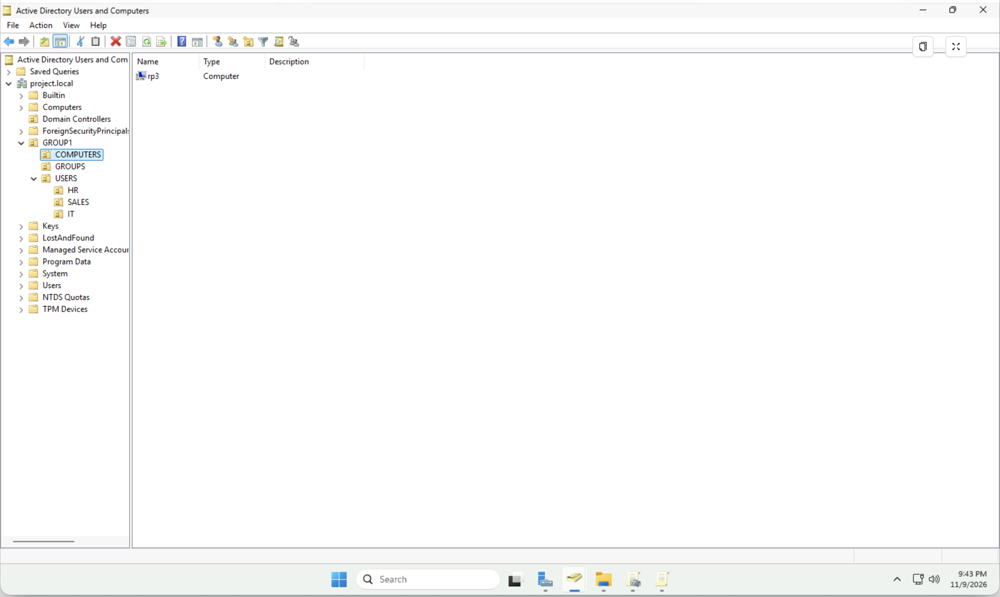
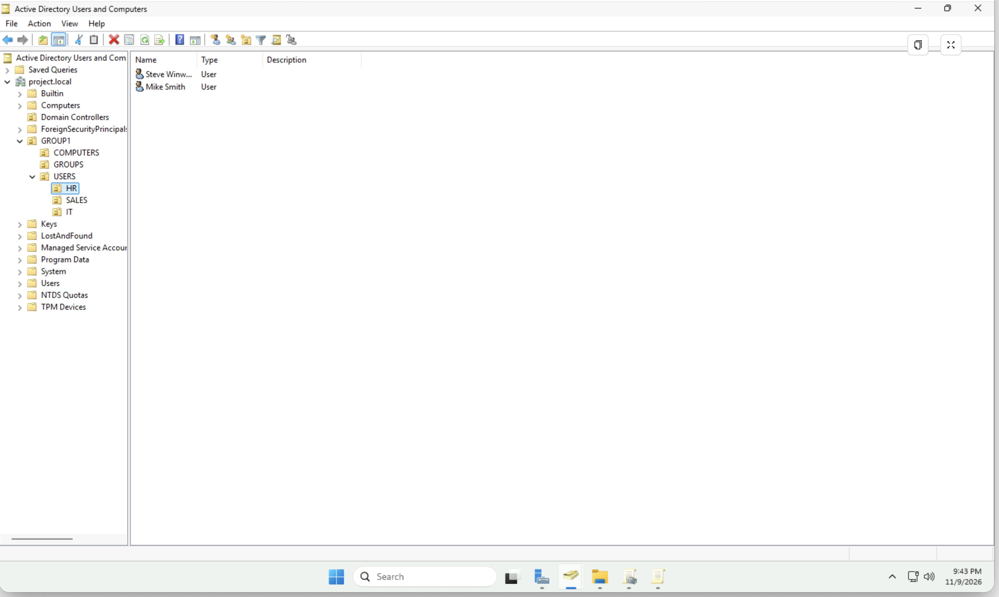
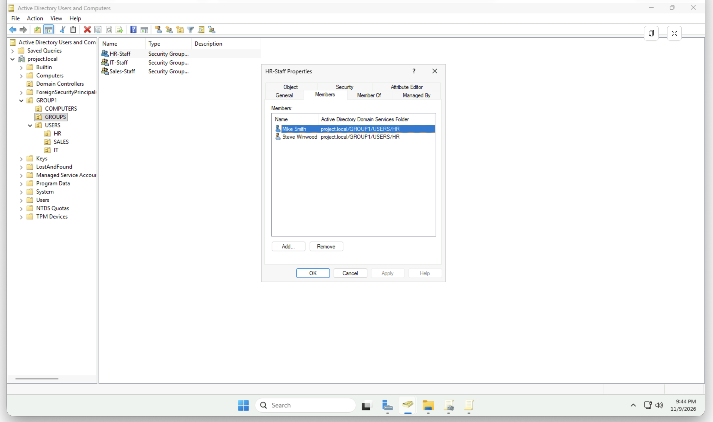
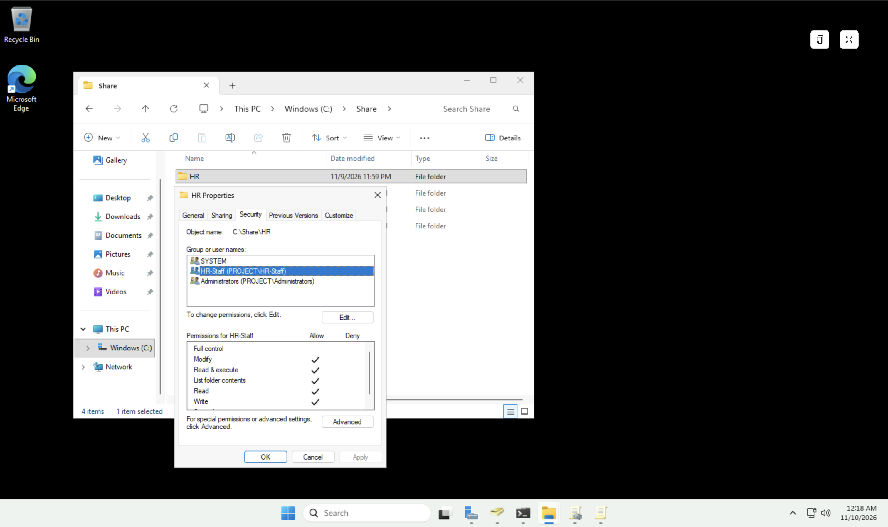
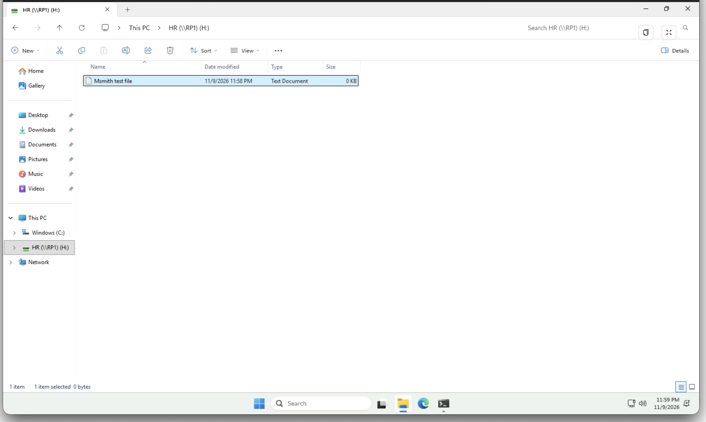
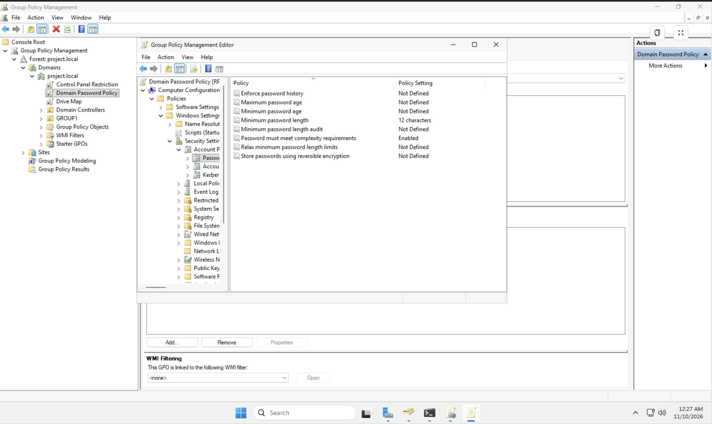
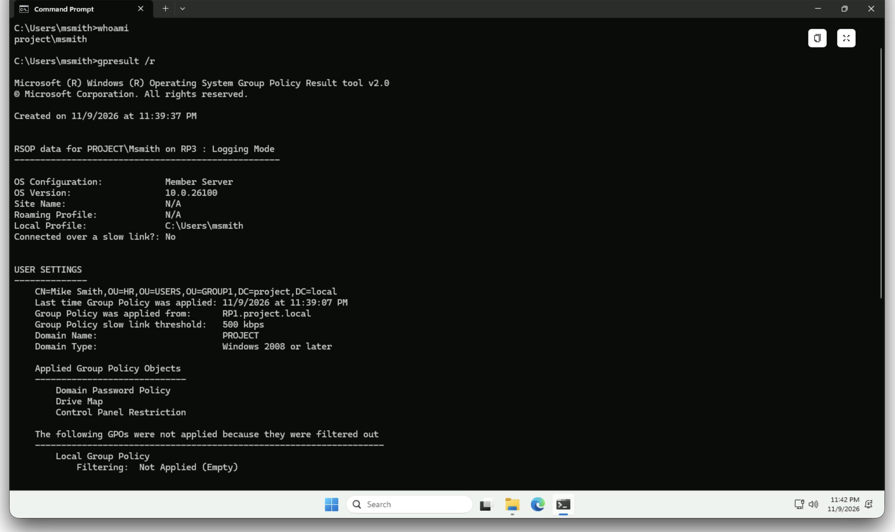

# Active Directory Lab in Microsoft Azure

## Overview
Built a Windows Server domain controller and a domain-joined Windows
client in an Azure virtual network, accessed through Azure Bastion.
Configured OUs, security groups, NTFS share permissions, and Group Policy.

## Environment
- Domain: project.local
- Domain controller: RP1 (AD DS, DNS, file services)
- Client: RP3 (Windows, domain-joined)
- Network: vnet-eastus-1 (East US)
- Access: Azure Bastion

## Architecture

*Domain controller, client, VNet, NSGs, and Bastion in one resource group*

## 1. Server roles and domain

*AD DS, DNS, and File Services running on the domain controller*

*RP3 joined to project.local and placed in the COMPUTERS OU*

## 2. Active Directory structure
Created an OU structure with HR, IT, and Sales departments and matching
security groups.

*Users in the HR OU*

*HR-Staff group membership*

## 3. File Share Permissions
Created department folders on the domain controller and restricted the HR folder to the HR-Staff security group using NTFS permissions.
- **HR folder:** accessible only to HR-Staff, Administrators, and SYSTEM
- **Access level:** HR-Staff has Modify (not Full control)

*HR folder permissions: HR-Staff, Administrators, and SYSTEM only*

*HR user accessing the HR share from the client*

## 4. Group Policy
Created three Group Policy Objects and verified them on the client with `gpresult`:

- **Domain Password Policy:** 12-character minimum and complexity required
- **Drive Map:** maps the HR shared drive for users
- **Control Panel Restriction:** blocks access to Control Panel

*Password policy settings*

*gpresult /r as PROJECT\msmith on RP3 showing all three GPOs applied*
